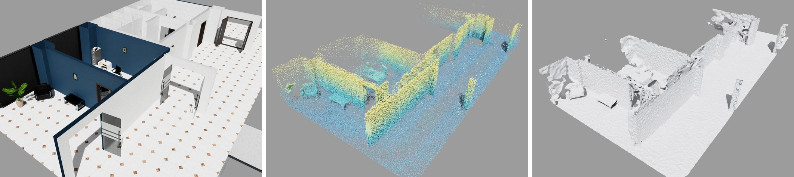

# lidar2sim

Задача хакатона «Сцены для симулятора из лидарного скана». Нужен конвейер одной командой: на входе облако точек помещения, на выходе сцена Isaac Sim с коллизиями и отчёт проверки.



*Слева направо: офис в Isaac Sim, облако лидара по этой сцене и сцена, восстановленная базовым решением. Потолок срезан, чтобы было видно помещения.*

В репозитории — рабочее базовое решение. Конвейер уже проходит от облака до сцены, которая загружается в Isaac Sim. Ваша задача — сделать сцену точной и физически корректной. Как именно — решаете вы.

Правила и пороги — [docs/rules.md](docs/rules.md).

## Данные

Сцена A — западное крыло офиса из Isaac Sim: кабинет с мебелью и Г-образный коридор. Облако снято лидаром на высоте 1,3 м по маршруту через сцену. Оно грязное, как настоящее SLAM-облако: шум дальности, выпадения, точки-призраки в воздухе и дрейф совмещения — стены местами двоятся.

| Файл | Содержимое |
|---|---|
| `A.ply` | Облако точек, 249 тыс. точек: XYZ в метрах, ось Z вверх |
| `trajectory_A.csv` | Положения лидара во время съёмки: `t,x,y,z` |
| `manifest.json` | Границы сцены, оси, описание файлов |
| `gt_mesh.ply` | Точная геометрия сцены — только для самопроверки, на вход конвейеру её подавать нельзя. Собирается скриптом, см. ниже |
| `test_config.json` | Тесты физики сцены A для `tools/isaac_scene_test.py` |

Облако, траектория и тесты лежат в репозитории, в `data/scene_a/`. Точную геометрию сцены соберите один раз сами:

```bash
.venv/bin/python tools/fetch_gt.py data/scene_a
```

Сцена скачивается с сервера NVIDIA без текстур. Условия использования:
[NVIDIA Isaac Sim Additional Software and Materials License](https://docs.isaacsim.omniverse.nvidia.com/6.2.0/common/license-isaac-sim-additional.html).
Исходные ассеты и собранный эталон не включаются в Git.

Скрипт создаёт согласованную пару `gt_mesh.ply` и `gt_scene.usd` в метрах/Z-up.
USD содержит visual и статический triangle-mesh collider; его можно использовать
для квалификации физических тестов. Перед сохранением проверяются число
треугольников, площадь, совпадение координат USD/PLY до 1 мкм и закреплённые хеши.
`gt_build.json` содержит параметры фильтров/обрезки, границы результата, SHA256
каждого исходного слоя и обоих выходных файлов. Фильтры стекла/городского фона,
шаг дробления и контрольные хеши зафиксированы в `manifest.json → gt`.
Обрезка сохраняет треугольники по центроиду после дробления; край может выступать
за границу области не более заданного `max_edge_m`.

При сетевом обрыве повторите ту же команду: готовые слои берутся из `nvidia/`,
незавершённая загрузка в кеш не попадает. Для временной сетевой ошибки предусмотрены
3 попытки с паузами 1 и 2 с, таймаут каждой — 60 с; HTTP 4xx (кроме 429) не
повторяется. Полный кеш позволяет повторить сборку без сети. При несовпадении
хешей скрипт завершается с ошибкой до замены выходных файлов: сначала выясните,
изменились ли исходные ассеты или окружение; не обновляйте контрольные хеши вслепую.

## Запуск

Нужен Python 3.10–3.12: под 3.13 и новее нет пакетов Open3D.

```bash
uv venv --python 3.11 .venv
uv pip install --python .venv/bin/python -e .
.venv/bin/python tools/fetch_gt.py data/scene_a

.venv/bin/python -m lidar2sim --input data/scene_a/A.ply \
    --manifest data/scene_a/manifest.json --trajectory data/scene_a/trajectory_A.csv \
    --config configs/baseline.yaml --out out/baseline
.venv/bin/python tools/eval_scene.py data/scene_a out/baseline
```

Без `uv` подойдёт обычный `python -m venv .venv && .venv/bin/pip install -e .`.

На macOS с Apple Silicon, если импорт Open3D 0.20 завершается ошибкой
`Library not loaded: .../libusb-1.0.0.dylib`, установите библиотеку: `brew install libusb`.

`tools/eval_scene.py` принимает несколько папок с результатами и выводит их рядом — удобно сравнивать свои версии.

Пороги геометрии и физики берутся из
[`configs/acceptance/lidar2sim-rules-v1.yaml`](configs/acceptance/lidar2sim-rules-v1.yaml).
Это конфиг приёмки, отдельный от параметров реконструкции. Прежние команды
используют его по умолчанию; можно передать путь явно:

```bash
.venv/bin/python tools/eval_scene.py data/scene_a out/baseline out/filtered \
    --profile configs/acceptance/lidar2sim-rules-v1.yaml
```

Отчёт оценки сохраняет id/hash профиля, режим `scene_a_gt_diagnostic`, сырые
метрики и результаты сравнения до округления. Верхние границы включаются.
Результаты четырёх реализованных проверок не означают полный зачёт PoC:
полнота collision отмечена `not_run`, а независимый B, размеры, физика, 10M
и скрытая сцена учитываются как отсутствующие обязательные проверки при
расчёте общего статуса. Подробный сводный отчёт по всем группам — HACKATHON-9.
Без обязательных проверок полный результат — `incomplete`
(или `failed`, если уже есть провал), а не `passed`.

### Эксперимент: восстановление пола

Конфиг `configs/floor.yaml` включает локальные заплатки пола после упрощения сеток.
Остальные параметры совпадают с baseline. Алгоритм оценивает почти горизонтальную
плоскость по нижним точкам облака с вертикальными нормалями. Ячейка добавляется,
если лучи обнаруживают пропуск или отклонение поверхности больше 4 см, а все её
углы находятся не дальше 25 см от измеренных точек пола. Треугольники смотрят вверх.
Эталон и координаты проверок алгоритм не читает.

```bash
.venv/bin/python -m lidar2sim --input data/scene_a/A.ply \
    --manifest data/scene_a/manifest.json --trajectory data/scene_a/trajectory_A.csv \
    --config configs/floor.yaml --out out/floor
.venv/bin/python tools/eval_scene.py data/scene_a out/baseline out/floor
.venv/bin/python -m unittest discover -s tests -v
```

В `report.json` раздел `floor` содержит число добавленных треугольников, площадь
заплаток и оценку высоты пола отдельно для visual и collision. Лимиты треугольников
относятся к сеткам до добавления заплаток. Исходные поверхности сохраняются;
на границах заплаток возможны перекрытия, которые нужно проверять в Isaac Sim.

Это эксперимент для одного почти горизонтального этажа. Лестницы, несколько
уровней и большие необследованные области он не восстанавливает. Небольшой
реальный проём в полу может быть принят за пропуск сканирования. Проверка лучами
не заменяет проверку физики и не гарантирует прохождение порогов хакатона.

Локальный прогон на сцене A (Open3D 0.20, Python 3.11):

| Проверка | Baseline | С заплатками |
|---|---|---|
| Visual в 5 см от эталона | 88,2% | 88,6% |
| Collision в 5 см от эталона | 88,6% | 89,1% |
| Эталон → visual, медиана / p95 | 1,71 / 4,82 см | 1,69 / 4,74 см |
| Луч вниз в центре каждой из 10 проверок пола, попадание ±5 см | 6/10 | 9/10 |
| Время без экспорта | 14,8 с | 15,1 с |

Порог точности 92% пока не пройден. На синтетической комнате покрытие пола
лучами выросло с 97,4% до 99,5%, покрытие пятна без точек — с 0% до 75%;
проём остался свободным. Физика этого варианта в Isaac Sim ещё не проверена.

Посмотреть обе сцены рядом в интерактивном окне:

```bash
.venv/bin/python tools/view_compare.py
```

Слева — baseline, справа — результат с заплатками (оранжевые участки).
По умолчанию показаны коллайдеры, потолок скрыт срезом на 1,6 м над полом.
Для визуальных сеток добавьте `--kind visual`. Вращение — перетаскивание левой
кнопкой мыши, масштаб — колесо, выход — Esc. Просмотр не запускает физику.

### Эксперимент: фильтрация лишних поверхностей

`configs/filtered.yaml` включает фильтр поддержки облаком и восстановление пола.
После Poisson, до упрощения, удаляются треугольники, чей центр дальше 8 см от
ближайшей точки подготовленного облака. Заплатки пола добавляются позже.
Эталон не используется. Параметр `support_radius: null` отключает фильтрацию.
Число удалённых треугольников записывается в `report.json → support_filter`.

```bash
.venv/bin/python -m lidar2sim --input data/scene_a/A.ply \
    --manifest data/scene_a/manifest.json --trajectory data/scene_a/trajectory_A.csv \
    --config configs/filtered.yaml --out out/filtered
.venv/bin/python tools/eval_scene.py data/scene_a out/baseline out/floor out/filtered
.venv/bin/python tools/view_compare.py --before out/baseline --after out/filtered
```

Локальная проверка сцены A, Open3D 0.20; повторная оценка с профилем v1
и независимой установкой seed для каждой выборки:

| Проверка | Baseline | Пол | Пол + фильтр |
|---|---|---|---|
| Visual в 5 см от эталона (≥92%) | 88,2% | 88,8% | 93,6% |
| Collision в 5 см от эталона (≥92%) | 88,6% | 89,1% | 94,7% |
| Эталон → visual, медиана / p95 | 1,71 / 4,82 см | 1,69 / 4,74 см | 1,69 / 4,74 см |
| Пол: лучи в центрах проверок, не физика | 6/10 | 9/10 | 9/10 |
| Время без экспорта | 14,8 с | 15,1 с | 15,7 с |

Независимые seed немного изменили выборку относительно прежнего замера
(88,6% для floor и 93,7% для filtered); сами сетки не перестраивались.
Удалено 22 485 из 617 337 треугольников до упрощения. Все четыре проверки
`eval_scene.py` пройдены. На синтетической комнате показатели варианта с полом
сохранились: покрытие пола 99,5%, проём свободен. Проверки физики, контрольных
размеров и скрытых сцен этим результатом не подтверждены. На более разреженных
облаках фиксированный радиус может удалить полезные поверхности.

Цветные карты для диагностики (отдельный инструмент, использующий эталон):

```bash
.venv/bin/python tools/color_errors.py data/scene_a/gt_mesh.ply out/baseline out/floor out/filtered
.venv/bin/python tools/view_compare.py --after out/filtered --errors
```

Зелёный — расстояние до эталона ≤3 см, жёлтый — 3–5 см, красный — >5 см.
Цвет вычислен в вершинах и интерполируется при отображении; метрики считаются
отдельно по равномерным выборкам поверхности. Цветные `*_errors.ply` не меняют
выходные сетки и не используются при сборке сцены.

Физика проверяется в Isaac Sim 6.2:

```bash
<isaac-sim>/python.sh tools/isaac_scene_test.py --scene out/baseline/scene.usd \
    --config data/scene_a/test_config.json --out out/baseline/physics.json \
    --profile configs/acceptance/lidar2sim-rules-v1.yaml
```

Как получить доступ к Isaac Sim на нашей машине, расскажем отдельно.

До старта симулятора скрипт проверяет профиль и совместимость порогов,
параметров корпуса, шага, скорости и числа тестов из `test_config.json`.
Неизвестная версия/поле профиля и конфликт конфигураций завершают команду
с ошибкой. Локальные тесты этих проверок не заменяют запуск физики на Spark.

Квалификация стенда требует 10/10 полов, 10/10 препятствий и 5/5 маршрутов
на GT, затем ожидаемых провалов на повреждённых сценах:

```bash
.venv/bin/python tools/make_physics_negatives.py data/scene_a out/physics-negatives
# Выполните isaac_scene_test.py для gt_scene.usd и каждого USD в physics-negatives,
# сохраняя отчёты в out/physics-check/{gt,missing_floor,missing_obstacle,blocked_passage}.json.
.venv/bin/python tools/check_physics_qualification.py out/physics-check \
    out/physics-negatives/cases.json --out out/physics-check/qualification.json
```

Генератор требует новый выходной каталог. Повреждённые сцены — только тестовые
фикстуры, их нельзя использовать как вход реконструкции. Проверка квалификации
сопоставляет хеши сцен, скрипта, конфига и профиля; общий `passed=false` без
ожидаемой причины провала недостаточен.

Тестовый корпус моделирует управляемые сани: нулевое трение обеих поверхностей
устраняет ложные остановки на плоском GT при задании скорости каждый шаг.
Контакты сохраняются: restitution=0, contact offset=0,02 м, rest offset=0,
решатель TGS, 16/4 итерации корпуса, CCD включён. Это проверка геометрии
коллизий, а не модель колёсного привода. `floor_z` маршрута задаёт высоту пола
в метрах (для старых конфигов по умолчанию 0). Отчёт сохраняет параметры,
версию Isaac, хеши входов и трассу маршрутов раз в секунду.

Проверено на Spark / Isaac 6.2, 10.11.2026:

| Сцена | Пол | Препятствия | Маршруты |
|---|---|---|---|
| GT | 10/10 | 10/10 | 5/5 |
| GT без участка пола | 9/10 | 10/10 | 5/5 |
| GT без препятствия | 10/10 | 9/10 | 5/5 |
| GT с перекрытым проходом | 10/10 | 10/10 | 3/5 |
| Реконструкция `filtered` | 7/10 | 6/10 | 5/5 |

Квалификация стенда пройдена: все три целевых повреждения обнаружены по ожидаемой
причине. Реконструкция **не проходит физическую приёмку**: три провала пола,
четыре превышения проникновения (5,02–11,89 см). Успешная геометрическая
диагностика и запись видео этого не заменяют.
[Хеши, настройки и причины провалов](docs/validation/hackathon-12-physics.json).
Полные отчёты и трассы находятся в `out/physics-qualification/results/`.

## Набор для проверки 10 млн точек

```bash
.venv/bin/python tools/make_dense_scan.py data/scene_a data/scene_10m
```

Каталог назначения должен быть новым. Генератор снимает GT независимыми лучами
из позиций `trajectory_A.csv` и сохраняет ровно 10 000 000 точек в `scene_10M.ply`
(binary little-endian XYZ float32), `trajectory.csv` и `manifest.json`.
Это плотная съёмка для производительности, не копирование точек A и не набор B.
Seed по умолчанию 20261110, дальность 20 м, азимут 360°, вертикальный диапазон ±45°,
шум дальности σ=0,02 м; выпадения, дрейф и точки-призраки отключены.
Manifest хранит точное число точек, число попаданий, распределение по позам,
измеренные параметры шума, версии, параметры генерации и SHA256.
Для побайтового воспроизведения используйте те же GT, траекторию, seed и версии.

Замер реконструкции начинается перед запуском команды и заканчивается после
записи всех её выходов. В него входят чтение 10M, обработка, построение обеих
сеток и экспорт USD; скачивание GT, генерация набора, оценка и запуск Isaac
измеряются отдельно. Не заменяйте вход заранее прореженной копией.

```bash
time .venv/bin/python -m lidar2sim --input data/scene_10m/scene_10M.ply \
    --manifest data/scene_10m/manifest.json --trajectory data/scene_10m/trajectory.csv \
    --config configs/filtered.yaml --out out/performance_10m
```

Готовность набора не означает выполнения требования ≤1800 с: сам замер и пиковая
память относятся к HACKATHON-17. Данные генерируются локально и не входят в Git.

## Контракт

**Вход**
| Файл | Содержимое |
|---|---|
| `scene.ply` | Облако точек: XYZ в метрах, ось Z вверх, единая система координат |
| `manifest.json` | Границы сцены (`bounds_min`, `bounds_max`), оси, источник, версия данных |
| `trajectory.csv` | Положения лидара во время съёмки: `t,x,y,z` |
| `config.yaml` | Параметры конвейера |

**Выход** — в папке `--out`:
| Файл | Содержимое |
|---|---|
| `visual.ply` | Сетка для отображения |
| `collision.ply` | Сетка для физики |
| `scene.usd` | Сцена Isaac Sim: метры, ось Z вверх, `/World/Visual` и `/World/Collision` со статическим коллайдером |
| `report.json` | Хеш входа, параметры, время каждого шага, размер сеток |

Названия файлов и структура `scene.usd` — интерфейс, по которому проверяется результат. Внутри конвейера можно менять что угодно.

## Ориентиры на сцене A

Исторические числа из исходного README и желаемый уровень. Это не результаты
повторного запуска baseline на квалифицированном выше стенде; для сравнения
физики baseline/filtered нужно заново прогнать обе сетки с одинаковыми настройками.

| Проверка | Порог | Базовое | Желаемый уровень |
|---|---|---|---|
| Сетка в пределах 5 см от эталона, visual | ≥ 92% | 88,2% | ≥ 94,7% |
| То же, collision | ≥ 92% | 88,6% | ≥ 93,1% |
| Эталон → сетка в области, которую видел A, медиана / p95 | ≤ 3 / ≤ 10 см | 1,7 / 4,8 см | ≤ 1,6 / ≤ 4,2 см |
| Isaac Sim: пол, позиций без провала | ≥ 9 из 10 | 8 из 10 | ≥ 9 из 10 |
| Isaac Sim: препятствия, проникновение ≤ 3,5 см | 10 из 10 | 10 из 10 | 10 из 10 |
| Isaac Sim: маршруты пройдены | ≥ 4 из 5 | 5 из 5 | ≥ 4 из 5 |
| Время | — | ~12 с | ~30 с |

Базовое решение не проходит два порога: лишняя геометрия и пол.

## Тестовая комната

Синтетическая комната 6×4×2,7 м с перегородкой, проёмом, ящиком и колонной — дымовой тест окружения, данные хакатона для неё не нужны. Подробно — [docs/baseline.md](docs/baseline.md).

```bash
.venv/bin/python tools/make_test_room.py data/test_room
.venv/bin/python -m lidar2sim --input data/test_room/scene.ply \
    --manifest data/test_room/manifest.json --trajectory data/test_room/trajectory.csv \
    --config configs/baseline.yaml --out out/test_room
.venv/bin/python tools/quick_eval.py data/test_room out/test_room
```

## Запись демонстрации в Isaac

В свободной сессии Isaac с доступным DISPLAY (на сервере используется Xvfb;
на общем Spark не запускать параллельно с другими симуляциями):

```bash
/isaac-sim/python.sh tools/isaac_record.py --scene out/filtered/scene.usd \
    --config data/scene_a/test_config.json --out out/isaac-recording
ffmpeg -framerate 24 -i out/isaac-recording/frames/%04d.png \
    -c:v libx264 -pix_fmt yuv420p -movflags +faststart out/isaac-recording/simulation.mp4
```

Выходной каталог должен быть новым. Скрипт сохраняет общий вид `overview.png`,
три кадра `simulation-*.png`, 240 кадров и `recording.json` с реальной траекторией
корпуса. Длительность — 10 секунд симуляции. Для обзора срезается только визуальная
сетка выше 1,6 м, коллизии остаются исходными. Это демонстрация, а не полный
приёмочный прогон. Проверено 10.11.2026 на Isaac 6.2 / NVIDIA GB10: записаны
240 кадров 1280×720 и траектория корпуса. Для рендера используется полное
приложение `isaacsim.exp.full.kit` под Xvfb.

## Файлы

| Путь | Что |
|---|---|
| `lidar2sim/baseline.py` | Базовое решение |
| `lidar2sim/common.py` | Чтение входа, подготовка облака, экспорт PLY/USD, отчёт |
| `configs/baseline.yaml` | Параметры базового решения |
| `data/scene_a/` | Данные сцены A |
| `tools/fetch_gt.py` | Точная геометрия сцены A: скачать у NVIDIA и собрать |
| `tools/eval_scene.py` | Проверки геометрии на сцене хакатона |
| `tools/isaac_scene_test.py` | Тесты физики в Isaac Sim по `test_config.json` |
| `tools/make_test_room.py`, `tools/quick_eval.py`, `tools/isaac_physics_test.py` | Тестовая комната: данные, быстрые проверки, физика |

## Независимые съёмки A/B (HACKATHON-13)

Новый кандидат набора строится из GT отдельным рейкастингом для A и B:

```bash
.venv/bin/python tools/make_ab_scans.py data/scene_a data/scene_ab_candidate \
    --trajectory-a configs/scans/trajectory_A_candidate.csv
```

Каталог назначения должен быть новым. По умолчанию получаются `A.ply` и `B.ply`
по 750000 точек, две траектории и общий `manifest.json` с параметрами и SHA256.
Исходное `data/scene_a/A.ply` не изменяется. В кандидатной траектории исправлена
одна поза (t=63,2 с, x +0,20 м): исходный отрезок пересекал GT. B снимается
из промежуточных позиций с высотой сенсора +0,10 м и другим seed. Перед съёмкой
проверяются зазор позиций ≥5 см и отсутствие пересечений отрезков с GT.

Профиль: дальность 0,05–20 м, азимут 360°, возвышение ±45°, шум дальности
A/B σ=0,02/0,01 м, случайные выпадения A=5%, B=0%. Секторные выпадения,
дрейф и призраки отключены и явно записаны в manifest. Это синтетическая
съёмка, не полная модель SLAM. После выпадений сбор продолжается до заданного
числа принятых точек. B предназначено только для оценщика; в реконструкцию
передаются исключительно A и trajectory_A.

Две полные сборки побайтово совпали; в каждом облаке 750000 уникальных конечных
точек. Измеренный σ A/B: 0,0199833 / 0,0100029 м; медиана расстояния до
треугольников GT: 0,0080364 / 0,0040894 м; p95: 0,0276690 / 0,0141029 м.
Измеренные выпадения A — 4,9627%. Доля 30000 равномерных по площади образцов
всего GT в пределах 10 см от облака: A 35,99%, B 35,85%. Эта диагностика
включает ненаблюдаемые поверхности и не заменяет общую область оценки H18.

Размер A=750000 пока предварительный: H3 должен согласовать расхождение
исходных требований. H13 остаётся In Progress до этого решения. Полный аудит:
[docs/validation/hackathon-13-independent-scans.json](docs/validation/hackathon-13-independent-scans.json).
Копия данных на Spark: `/home/unknown641/lidar2sim-data/scene_ab_candidate/`.

## Разметка и общая область A/B (HACKATHON-18)

```bash
.venv/bin/python tools/annotate_scene.py data/scene_a data/scene_ab_candidate out/annotations-v1 \
    --definition configs/scans/annotations-v1.json
.venv/bin/python tools/render_annotations.py data/scene_ab_candidate out/annotations-v1 out/annotations-v1/overlay.png
```

Каталог сборки должен быть новым. `annotations.json` содержит 10 размеров
(три ширины/высоты открытых дверей, глубина/высота южной комнаты, глубина
столешницы и колонны), направления измерения, опорные поверхности и области
поиска для H20. Обе опорные поверхности каждого размера наблюдаются в A и B.
Размеры считаются по GT только при подготовке разметки: будущий измеритель
должен искать поверхности восстановленного меша, а не возвращать эталонную длину.

Три проверенных проёма имеют ширины 0,87888 / 1,84046 / 2,00000 м и высоты
2,06505 / 2,45712 / 2,50000 м. Для каждого проверены 425 лучей через стену
толщиной 0,50 м (отступ 5 см от границ) и геометрическое вмещение корпуса
0,4×0,4×0,3 м. Это дискретная геометрическая проверка, не новый физический
проезд через каждую дверь. Две 94-сантиметровые рамы закрыты полотнами GT
и не включены в список проходов.

`eval_region.npz` хранит 300000 равномерных по площади GT образцов с seed=18,
числа соседей A/B и общую маску. Правило: минимум 10 точек **каждого** облака
в радиусе 0,10 м. Общая область содержит 85462 образца (28,4873% площади GT).
`lidar2sim.annotations.observed_by_both` задаёт то же правило для любых
запрашиваемых точек; будущий оценщик H19 использует его для обеих сеток.
Нельзя строить область отдельно по результату каждого решения.

[Визуальная проверка](docs/img/annotations-v1.png): слева сверху GT, справа
сверху A, слева снизу B, справа снизу общая область. Сетка — 1 м; красные
номера — D01–D10, оранжевые линии — проёмы. Показан срез 0,7–1,8 м;
опорные поверхности высот могут находиться вне этого среза.

[Аудит разметки](docs/validation/hackathon-18-annotations.json) содержит хеши,
результаты и привязку к квалификации H12 (10 полов, 10 препятствий, 5 маршрутов).
Она переиспользована только после точного совпадения GT USD и test_config.json;
новая Isaac-сессия не запускалась. Две сборки разметки побайтово совпали.
Пакет на Spark: `/home/unknown641/lidar2sim-data/annotations-v1/`.

Профиль разметки предварительный и привязан к текущему кандидату A/B. После
решения H3 о размере A или изменения данных пакет надо пересобрать. Существующий
`eval_scene.py` пока работает в прежнем диагностическом режиме; интеграция
независимых метрик и контрольных размеров относится к H19/H20.

## Независимая оценка B и общая область (HACKATHON-19)

```bash
.venv/bin/python tools/eval_scene.py data/scene_a out/filtered \
    --mode b --scans data/scene_ab_candidate --annotations out/annotations-v1-observed
# Сравнение с GT в той же области:
.venv/bin/python tools/eval_scene.py data/scene_a out/filtered \
    --mode gt --scans data/scene_ab_candidate --annotations out/annotations-v1-observed
```

Каждый запуск сохраняет `eval_scene.json` в каталоге решения, заменяя предыдущий
отчёт. Для сохранения обоих режимов используйте отдельные каталоги с сетками
или скопируйте первый отчёт. Без `--mode` остаётся прежняя диагностика A/GT.

Новые режимы проверяют хеши пакета H18, общей области, A/B и GT. Для **visual
и collision отдельно** выдаются доля поверхности, median/p95, сырые значения
в метрах, проверки порогов, число включённых/исключённых образцов и provenance.
Пустая область или менее 1000 подходящих образцов — ошибка, не успешная оценка.
Порядок сравниваемых решений не влияет на результаты.

Направления метрик:

- Доля поверхности: равномерные по площади образцы восстановленной сетки,
  чей ближайший участок GT удовлетворяет общему правилу A/B, → треугольники GT. Профиль v1 по-прежнему
  требует ≥92% в пределах 5 см; это **не** независимая B-метрика.
- Полнота `--mode gt`: сохранённые равномерные образцы GT общей области →
  треугольники восстановленной сетки.
- Полнота `--mode b`: для тех же равномерных опорных образцов выбирается
  ближайший реальный возврат B в пределах радиуса области; затем расстояние
  считается **от координат B** до треугольников восстановленной сетки.
  Повторно выбранные возвраты сохраняют вес соответствующих опорных образцов.

Такой выбор B приближает взвешивание по площади GT, а не по плотности возвратов.
Это выборка, направляемая GT; она не является полностью независимой от GT
процедурой и не создаёт несуществующую поверхность B. В отчёте есть тип выборки,
число уникальных возвратов и расстояния привязки: на текущем наборе используются
85462 опорных образца и 74363 уникальных возврата B; медиана/максимум привязки —
1,50/9,01 см. B поступает только в оценщик; конвейер реконструкции не изменён.

Проверенные результаты в общей области, p95 в сантиметрах:

| Решение | B → visual | B → collision | GT → visual | GT → collision |
|---|---:|---:|---:|---:|
| GT | 1,12 | 1,12 | <0,001 | <0,001 |
| baseline | 11,88 | 15,03 | 12,33 | 15,23 |
| filtered | 10,98 | 14,81 | 11,60 | 14,97 |

GT проходит реализованную геометрию. Baseline и filtered превышают p95 ≤10 см
в обоих режимах; PoC не принят. Эти значения нельзя смешивать со старой
диагностикой другой области. Исходная проба с выборкой сырых возвратов B
переоценивала плотно снятые участки; её результаты сохранены отдельно в
`out/evaluation-h19-returnweighted` и не являются итогом H19.

[Полный аудит](docs/validation/hackathon-19-independent-evaluation.json),
отчёты `out/evaluation-h19/{b,gt}/{gt,baseline,filtered}/eval_scene.json`.
Контрольные размеры остаются задачей H20; физику и производительность этот
скрипт не запускает. Профиль и кандидат A/B всё ещё требуют решения H3.

## Контрольные размеры реконструкции (HACKATHON-20)

```bash
.venv/bin/python tools/eval_scene.py data/scene_a out/filtered \
    --mode b --scans data/scene_ab_candidate --annotations out/annotations-v1-observed \
    --dimensions
```

`--dimensions` добавляет в `eval_scene.json` десять измерений отдельно для
visual и collision. Без флага поведение H19 сохраняется. Поддерживаются
произвольные единичные направления измерения, включая ширину, глубину и высоту.
Разметка задаёт только соответствие поверхностей и эталон для сравнения;
измеренные точки получаются пересечением лучей с **восстановленным мешем**.

Метод `local-ray-bundle-v1`: центральный луч и четыре поперечных со смещением
5 мм с каждой стороны. Центральное пересечение и минимум 4/5 проб должны
лежать в размеченной области поиска; проекция нормали на ось — не меньше 0,8.
Разброс положений поверхности вдоль оси больше 2 см означает неоднозначность.
Длина берётся по центральным пересечениям, а ошибка сравнивается с порогом
профиля ≤5 см без округления. Метод локальный: он не подменяет измерение
поиском произвольной похожей поверхности за пределами областей H18.

Каждый результат содержит `reference_m`, `measured_m`, `absolute_error_m`,
`surface_points_m`, число действительных проб, разброс и статус. Отсутствующая,
неподходяще ориентированная или неоднозначная поверхность даёт `status=error`,
`measured_m=null`, `passed=false` и причину. Это не успешное измерение с нулём.
Любой такой результат делает группу размеров и PoC неуспешными.

На текущем наборе GT проходит **10/10 на каждой сетке**, ошибка центральных
измерений менее 1 мкм. Baseline и filtered проходят **6/10 на каждой сетке**.
У filtered visual ошибки поиска поверхностей: D01 (ширина юго-западного
проёма), D07 (глубина комнаты), D09 (глубина столешницы), D10 (глубина колонны).
У filtered collision: D01, D03 (ширина северо-восточного проёма), D07, D09.
Они не заменяются эталонными значениями и требуют проверки/исправления геометрии.

[Полный аудит H20](docs/validation/hackathon-20-dimensions.json).
Отчёты: `out/evaluation-h20/{gt,baseline,filtered}/eval_scene.json`.
Тесты включают изменение ширины/высоты на 10 см, отсутствующие поверхности,
ступенчатую неоднозначную поверхность и интеграцию CLI. Физика и
производительность этим запуском не проверяются; их статусы не наследуются
из геометрических результатов.

## Регрессия оценщика (HACKATHON-22)

```bash
.venv/bin/python tools/check_evaluator.py out/evaluator-regression
```

Нужен новый каталог. Команда без сети/Isaac создаёт эталонный куб, A/B,
разметку, три дефекта и отчёты; код возврата 0 означает успешную регрессию,
1 — несовпадение хотя бы одного ожидаемого результата. Используются 12000
образцов для быстрой синтетической проверки; приёмочные пороги не меняются.
Это проверка оценщика, не приёмка реальной Office-сцены.

Проверены 18 условий в режимах B и GT для обеих сеток:

- GT проходит геометрию и 10/10 размеров; GT p95 ≤2 мкм, B p95 ≤1 см.
- Сдвиг +10 см по X проваливает долю точной поверхности: 66,54% при ≥92%.
- Удаление стены X=2 проваливает полноту (p95 около 44 см) и соответствующие размеры.
- Расширение по X на 10 см даёт ошибку размера 0,10±0,000002 м.
- Отдельные, прямые и обратные запуски дают идентичные JSON; допустимый
  численный разброс задан 1e-12, фактически отчёты полностью совпадают.

Регрессия выявила и исправила исключение смещённых поверхностей из области
проверки. Теперь принадлежность определяется по ближайшей **поверхности GT**,
наблюдаемой A/B, а расстояние — от исходного образца реконструкции. Таким
образом, ошибка положения не исключает сама себя из метрики. Это отражено
в `precision_region_membership`; прежние доли точности H19 исторические.

Повторная Office-проверка B с размерами: GT проходит геометрию и 10/10;
baseline — 89,38% / 89,81% точной поверхности visual/collision, filtered —
93,72% / 94,72%. Размеры у обеих реконструкций остаются 6/10; filtered также
не проходит прежний порог p95. Исправление не означает приёмку реконструкции.

[Аудит регрессии и Office](docs/validation/hackathon-22-evaluator-regression.json),
[положительный JSON](docs/validation/hackathon-22-examples/gt.json),
[отрицательный JSON](docs/validation/hackathon-22-examples/shift_10cm.json).
Два полных запуска регрессии дали идентичный итоговый JSON. Физика,
производительность и скрытая сцена этой командой не проверяются.

## Веб-интерфейс

Загрузка PLY, 3D-просмотр и скачивание реконструированной сцены:

```bash
.venv/bin/python -m lidar2sim.web.server
```

Откройте http://127.0.0.1:8765. [Инструкция и ограничения](docs/web-ui.md).
